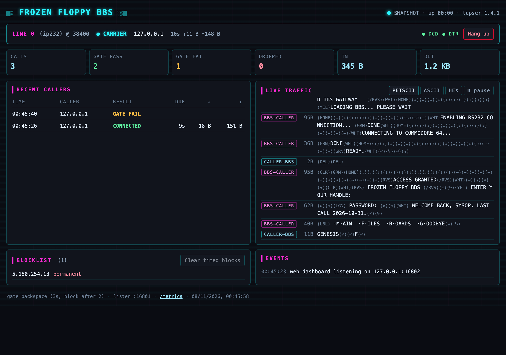
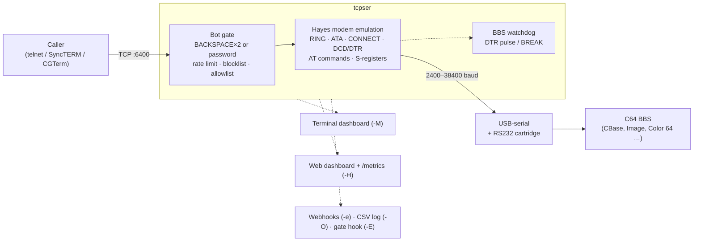
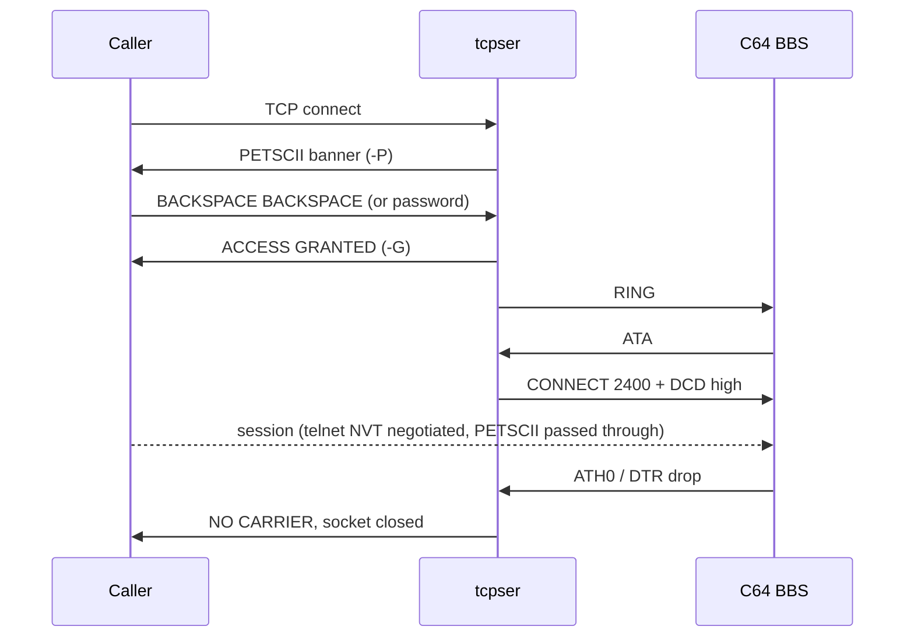
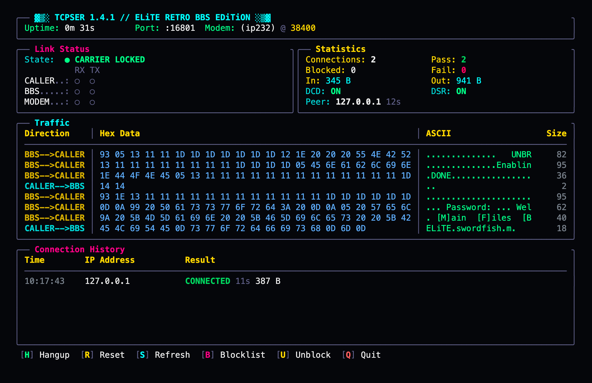
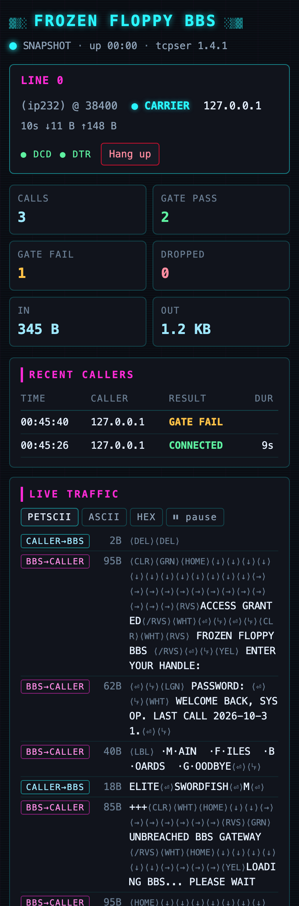
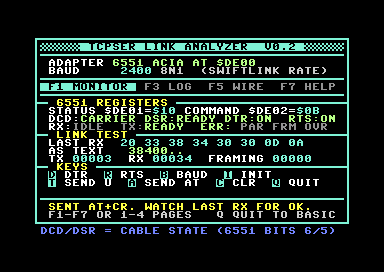
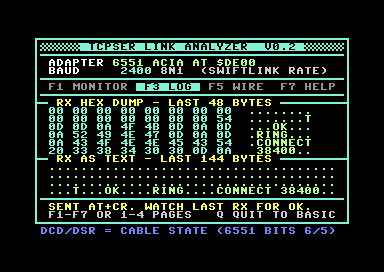

<h1 align="center">TCPSER · ELiTE RETRO BBS EDiTiON</h1>

<p align="center">
  <b>Put your Commodore 64 BBS on the Internet.</b><br>
  A hardened fork of <code>tcpser</code> that turns a USB-serial port into a Hayes modem over TCP/IP,<br>
  with a bot gate, IP blocklist, live dashboards, BBS watchdog and an RS232 adapter analyzer.
</p>

<p align="center">
  <a href="LICENSE"></a>
  
  
  
  
</p>

<p align="center">
  
</p>

<p align="center"><sub>GENESiS-PROJECT // built for the FRoZEN FLoPPY BBS · modded by David Jacoby (david@unbreached.se) · original tcpser by Jim Brain</sub></p>

---

## Table of contents

- [How it works](#how-it-works)
- [Quick start](#quick-start)
- [Features](#features)
- [Dashboards](#dashboards)
- [Security](#security)
- [BBS recovery](#bbs-recovery)
- [Hardware, cabling and the analyzer](#hardware-cabling-and-the-analyzer)
- [Running as a service](#running-as-a-service)
- [Reference](#reference) (all options, environment variables, AT commands, S-registers, logs, signals)
- [Troubleshooting](#troubleshooting)
- [Documentation, structure, license](#documentation)

---

## How it works

tcpser sits between the Internet and the serial port. To the caller it is a telnet
host; to the BBS it is a Hayes modem that rings, answers `ATA`, raises carrier and
drops it on hang-up. Everything a caller sends is checked by the gate, rate limiter
and blocklist **before** a single byte reaches the serial port.



Flow of one call:



---

## Quick start

```bash
# 1. Build (gcc + make; Linux, macOS, Raspberry Pi OS, BSD)
make

# 2. Find the right settings for your cartridge and cable
./tcpser -d /dev/ttyUSB0 -s 2400 -Z

# 3. Host the BBS on TCP 6400 with the BACKSPACE×2 bot gate
./tcpser -d /dev/ttyUSB0 -s 2400 -p 6400 -x

# 4. Same, with the terminal dashboard, log file and connection log
./tcpser -d /dev/ttyUSB0 -s 2400 -p 6400 -x -M -L tcpser.log -O connections.csv
```

Call yourself from another machine with `telnet <host> 6400` (or SyncTERM / CGTerm
for proper PETSCII), press BACKSPACE twice, and your BBS should answer.

**Test** with `make check` (drives a full modem session, the gates, the web dashboard,
CLI validation and a pty port-loss scenario against the built binary) or
`make check-asan` (same suite against an AddressSanitizer/UBSan build; needs clang).

**Install system-wide** with `sudo make install` (binary to `/usr/local/bin`, man page,
PETSCII screens and service files to `/usr/local/share/tcpser/`; override with
`PREFIX=`). `sudo make uninstall` removes the binary and man page.

**Requirements:** a USB-serial adapter (FTDI recommended) and a C64 RS232 cartridge:
SwiftLink-232, CMD Turbo232, GGLABS GLINK232, or a userport adapter with a MAX232
level shifter. No libraries beyond libc and pthreads.

---

## Features

| | |
|---|---|
| 🛡️ **Bot gate** | Callers must press BACKSPACE twice (`-x`) or type a password (`-k`) before the modem rings. Scanners and bots never touch the serial port. |
| 🚫 **Blocklist / allowlist** | Persistent IP blocklist with automatic blocking after N gate failures, per-IP rate limiting, and an allowlist for friends that skips the gate. |
| 📟 **Terminal dashboard** | Full-screen monitor (`-M`): link state, activity LEDs, hex + ASCII traffic, connection history, hotkeys to hang up or block. |
| 🌐 **Web dashboard + metrics** | `-H` serves a live page (Server-Sent Events), a JSON API and a Prometheus `/metrics` endpoint. Loopback and token-protected by default. |
| 🔔 **Webhooks** | Discord, Slack, ntfy or any JSON endpoint on connect, disconnect, gate failure and block. Secrets never appear in `ps`. |
| 🐕 **BBS watchdog** | Detects a hung BBS after an ungraceful disconnect and pulses DTR / sends BREAK so the 6551 sees carrier loss. Max-session timer against line hogging. |
| 🔌 **USB resilience** | Survives the adapter disappearing: waits for the device and reopens it, no restart. |
| 🩺 **RS232 analyzer** | `-Z` detects the baud rate from the BBS init, maps DTR/RTS wiring, verifies an `OK` exchange and recommends flags. A C64-side companion lives in [`c64/`](c64/). |
| 🎨 **PETSCII screens** | Pre-connect banner and access-granted screens (`.seq`), with random banner rotation from a directory. |
| 📈 **Logging** | CSV connection log (mode 0600), persisted counters, log rotation on SIGHUP, hex traces per direction. |
| 🖧 **Multi-line** | Several `-d`/`-v` modems behind one or more TCP ports (`-p 6400:0,1 -p 6401:2`). |
| 🔒 **Hardened build** | Stack protector, FORTIFY, PIE, full RELRO; constant-time secret compares; fuzzed parsers; no shell in any exec path. |

---

## Dashboards

<table>
<tr>
<td width="50%" valign="top">

**Terminal (`-M`)** — runs on stderr, over SSH, on a Pi. Link state and LEDs,
live hex/ASCII traffic in both directions, connection history, blocklist
overlay. Destructive hotkeys ask `y/N`.

| Key | Action |
|-----|--------|
| `H` | Hang up the current caller |
| `R` | Reset the modem (same as `ATZ`) |
| `B` | Show the IP blocklist |
| `U` | Clear all timed blocks |
| `S` | Back to the dashboard / refresh |
| `Q` | Quit (hangs up callers, saves stats) |

</td>
<td width="50%" valign="top">

**Web (`-H port`)** — works without `-M`. Per-line status (carrier, caller,
duration, bytes, DCD/DTR), counters, recent callers, a live traffic feed with
PETSCII / ASCII / hex views, the blocklist and system events, updated every
2 s over Server-Sent Events. Hang up a caller or clear timed blocks from the
page. Works on a phone. Name it with `TCPSER_DASH_NAME="My BBS"`.

| Endpoint | Returns |
|----------|---------|
| `/` | the dashboard page (`/?token=…` once to sign in) |
| `/api/status` | JSON: lines, gate, stats, history, traffic, blocklist, events |
| `/api/events` | SSE `status` events every 2 s |
| `/metrics` | Prometheus text (`tcpser_*`, per-line `tcpser_line_connected`) |
| `POST /api/line/N/hangup`, `POST /api/unblock` | actions (need `X-Requested-With: tcpser`) |

Binds `127.0.0.1`. See [Security](#security) before exposing it. The page lives
in `src/web/` and is embedded into the binary at build time.

</td>
</tr>
</table>

<p align="center">
  
</p>
<p align="center">
  
</p>

---

## Security

Everything below runs **before** any byte reaches the serial port.

| Mechanism | Flag / setting | Notes |
|-----------|----------------|-------|
| BACKSPACE×2 gate | `-x` | accepts 0x08, 0x14 (PETSCII DEL) and 0x7F |
| Password gate | `-k secret` or `-k env:VAR` | PETSCII/ASCII normalized, constant-time compare, guesses capped and throttled per connection; `env:` keeps it out of `ps` |
| Gate timeout / failures | `-W 20` · `-F 3` | after `-F` failures the IP is blocked permanently |
| Rate limiting | built in | 5 s minimum between attempts from one IP |
| Blocklist | `TCPSER_BLOCKLIST=/var/lib/tcpser/tcpser.blocklist` | one IPv4 per line, `#` comments, atomic append, reloaded on change |
| Allowlist | `TCPSER_ALLOWLIST=…` | trusted IPs skip gate, rate limit and blocklist |
| Gate hook | `-E gate_success_log` | a script **name** in `/usr/local/tcpser/scripts/`; runs detached, caller IP in `TCPSER_PEER_IP`; see [`samples/scripts/README.md`](samples/scripts/README.md) |
| Web dashboard exposure | `TCPSER_DASH_BIND` · `TCPSER_DASH_TOKEN` · `TCPSER_DASH_TRAFFIC` | loopback by default; a token is required to expose it; visit `/?token=…` once and the browser keeps an HttpOnly SameSite cookie, so the token never stays in the address bar or proxy logs; payload preview is opt-in because it can contain what callers type |
| ip232 (`-v`) listener | `TCPSER_IP232_BIND` | the emulator side is the *trusted* modem channel: loopback by default, never expose it unprotected |

```bash
# Expose the dashboard on the LAN with a random token
export TCPSER_DASH_BIND=0.0.0.0
export TCPSER_DASH_TOKEN=$(head -c16 /dev/urandom | xxd -p)
tcpser -d /dev/ttyUSB0 -s 2400 -p 6400 -x -H 8080
# → open http://host:8080/?token=<value> once; the page then runs on a cookie
```

Deployment hardening (unprivileged systemd unit, nginx + TLS, fail2ban jails for the
modem port and the dashboard, firewall rules) is in [`samples/`](samples/README.md)
and [`docs/SECURITY_GUIDE.md`](docs/SECURITY_GUIDE.md). The full 2026-11 audit, with
what was found and fixed, is in [`docs/AUDIT-2026-11-01.md`](docs/AUDIT-2026-11-01.md).

---

## BBS recovery

| | |
|---|---|
| **Watchdog** (`-w 120`, `0` = off) | If no serial data arrives from the BBS within the timeout after a disconnect, tcpser pulses DTR (500 ms) so the 6551 reports carrier loss; after three pulses it sends a serial BREAK. Resets when the BBS talks. Works with CBase's `chkcarr`. |
| **Consecutive no-answer** | Three callers in a row getting no answer triggers a DTR pulse. |
| **Max session** (`-m 60`) | Disconnects a caller after N minutes. `0` = unlimited. |
| **USB reconnect** | If the adapter vanishes, the current caller gets NO CARRIER and tcpser waits for the device node to come back and reopens it (warning once a minute). |
| **DTR grace** | DTR drops in the first seconds after CONNECT are ignored so a BBS reset sequence cannot hang up a fresh call. |
| **ATZ keeps your wiring** | `ATZ` / `AT&F` restore the profile given with `-i` and `-I` (inverted DCD, `&C0`, `&K3`), not factory defaults. |

---

## Hardware, cabling and the analyzer

### Supported adapters

| Adapter | Chip | Max baud |
|---------|------|----------|
| SwiftLink-232 | 6551 ACIA | 38400 |
| CMD Turbo232 | 6551 + extension register | 230400 |
| GGLABS GLINK232 | SwiftLink-compatible (3 BOM variants) | 38400 |
| Userport adapters | software UART | 300–2400 |
| UP9600 mod | CIA shift register | 9600 |

All 6551-based cartridges **disable their receiver while DCD is inactive**. tcpser
drives DCD from the PC's DTR line and asserts it on carrier. If your BBS expects DCD
while idle, pass `-i "&C0"`; if the adapter inverts it, pass `-I`.

### Cable

```
   PC (USB-serial)        C64 cartridge
        TXD ─────────────── RXD
        RXD ─────────────── TXD
        RTS ─────────────── CTS
        CTS ─────────────── RTS
        DTR ─────────────── DCD      ← tcpser signals carrier here
        DCD ─────────────── DTR
        GND ─────────────── GND
```

A 3-wire cable (TX/RX/GND) works with `-i "&D0"`, but tcpser then cannot see the
C64 hanging up.

### Analyzer (`-Z`)

```bash
tcpser -d /dev/ttyUSB0 -s 2400 -Z
```

| Step | You | It |
|------|-----|----|
| 1 | start (or restart) the BBS so it sends its AT init | listens at each baud rate and picks the one that yields valid AT commands |
| 2 | nothing | toggles DTR/RTS and watches which inputs move: detects null-modem cross-wiring and 3-wire cables |
| 3 | nothing | sends `OK` and checks the BBS accepts it |
| report | | infers the cartridge type and prints a recommended command line |

Flow control and parity are not probed; the `&K` suggestion is a heuristic to verify.

<p align="center">
  
  <br>
  <sub><a href="c64/">c64/tcpser-link.prg</a>: the C64-side companion. Live 6551 registers decoded to cable DCD/DSR/DTR/RTS, send <code>AT</code> and read tcpser's <code>OK</code> on the C64, toggle DTR/RTS to map the wiring, and a log page with everything tcpser sent. Four pages (F1–F7), runs on hardware or in VICE against a live tcpser over ip232.</sub>
</p>

---

## Running as a service

**Linux (systemd)** — the unit runs tcpser as an unprivileged user with a writable
state directory for the blocklist and stats:

```bash
sudo useradd --system --no-create-home --shell /usr/sbin/nologin -G dialout tcpser
sudo cp /usr/local/share/tcpser/tcpser.service /etc/systemd/system/
sudo systemctl edit --full tcpser      # device, speed, port, gate on the ExecStart line
sudo systemctl enable --now tcpser
```

Secrets (dashboard token, `-k env:TCPSER_GATE_PASSWORD`) go in `/etc/tcpser/tcpser.env`.
The hardened variant and an installer are in [`samples/systemd/`](samples/systemd/) and
[`samples/deployment/install_secure.sh`](samples/deployment/install_secure.sh).

**macOS (launchd)**

```bash
sudo cp /usr/local/share/tcpser/com.tcpser.bbs.plist /Library/LaunchDaemons/   # edit paths first
sudo launchctl load /Library/LaunchDaemons/com.tcpser.bbs.plist
```

Both restart tcpser automatically. `kill -HUP` reopens the log file (logrotate),
`kill -USR1` dumps statistics.

---

## Reference

<details>
<summary><b>All command-line options</b> (also <code>tcpser -h</code> and <code>man tcpser</code>)</summary>

Options are validated at startup: a bad value prints a message and exits with code 2.

**Serial port**

| Flag | Description |
|------|-------------|
| `-d <device>` | Serial device, e.g. `/dev/ttyUSB0`. Repeat for more lines |
| `-v <port>` | Virtual RS232 over TCP (ip232 / VICE). Binds `127.0.0.1` |
| `-s <speed>` | Serial speed (default 38400; standard rates 300–230400) |
| `-S <speed>` | Speed reported in `CONNECT` (default = `-s`) |
| `-i <string>` | Modem init string without `AT`, e.g. `-i "&C0&K3S0=1"` |
| `-I` | Invert the DCD line |
| `-b <list>` | On-connect caller speed menu for CBase: `-b 2400=6,9600=8,38400=10` (`speed=POKE 838 value`) |

**Network**

| Flag | Description |
|------|-------------|
| `-p <port>[:modems]` | TCP listen port (default 6400, all modems); `-p 23:0,1 -p 64128:2` |
| `-n <number>=<host:port>` | Phone book entry for `ATD<number>` |
| `-D <host:port>` | Direct connection (`:` alone = receiver mode) |

**Security / bot gate**

| Flag | Description |
|------|-------------|
| `-x` | Require BACKSPACE twice before the modem rings |
| `-k <password>` | Require a password (`-k env:VAR` reads it from the environment) |
| `-W <seconds>` | Gate timeout (default 20, max 300) |
| `-F <count>` | Gate failures before a permanent block (default 3) |
| `-P <file\|dir>` | Pre-connect PETSCII banner; a directory rotates banners randomly |
| `-G <file>` | Access-granted screen |
| `-E <name>` | Gate-success hook: script name in `/usr/local/tcpser/scripts/` |

**Event screens** (PETSCII `.seq` files sent when the event happens)

| Flag | Event | Sent to |
|------|-------|---------|
| `-a` / `-A` | answer | C64 / caller |
| `-c` / `-C` | connect | C64 / caller |
| `-N` | no answer | caller |
| `-B` | all lines busy | caller |
| `-T` | inactivity timeout | caller |

**Logging and monitoring**

| Flag | Description |
|------|-------------|
| `-l <0-7>` | Log level: 0 none, 1 fatal … 4 info … 7 trace |
| `-L <file>` | Log file (SIGHUP reopens it) |
| `-t <flags>` | Hex traces: `m`/`M` modem in/out, `s`/`S` serial, `i`/`I` IP |
| `-O <file>` | Connection CSV log (created mode 0600) |
| `-Y <file>` | Persist counters across restarts |
| `-M` | Terminal dashboard (needs a tty) |
| `-H <port>` | Web dashboard + `/metrics` |
| `-e <url>` | Webhook (repeatable, up to 8) |

**Recovery and tools**

| Flag | Description |
|------|-------------|
| `-w <seconds>` | BBS watchdog (default 120, 0 = off, max 600) |
| `-m <minutes>` | Max session time (default 0 = unlimited) |
| `-Z` | RS232 analyzer (needs `-d`) |
| `-V` / `-h` | Version / help |

`-s`, `-S`, `-i` and the gate settings propagate to later `-d`/`-v` modems.

</details>

<details>
<summary><b>Environment variables</b></summary>

| Variable | Effect | Default |
|----------|--------|---------|
| `TCPSER_BLOCKLIST` | blocklist file | `tcpser.blocklist` in the working directory |
| `TCPSER_ALLOWLIST` | allowlist file | `tcpser.allowlist` in the working directory |
| `TCPSER_DASH_BIND` | web dashboard bind address | `127.0.0.1` |
| `TCPSER_DASH_TOKEN` | require `?token=…` on the dashboard | none |
| `TCPSER_DASH_TRAFFIC` | `1` = include payload bytes in the traffic feed | off |
| `TCPSER_DASH_NAME` | BBS name shown in the dashboard header | `TCPSER` |
| `TCPSER_IP232_BIND` | bind address of the `-v` listener | `127.0.0.1` |

</details>

<details>
<summary><b>AT commands and S-registers</b></summary>

| Command | Effect |
|---------|--------|
| `ATA` | answer |
| `ATD<number>` / `ATDL` | dial (TCP connect) / redial |
| `ATH0` / `ATH1` | hang up / off-hook |
| `ATO` | back to online data mode |
| `ATE0/1` · `ATQ0/1` · `ATV0/1` | echo · quiet · numeric/verbose |
| `ATX0`–`ATX4` · `ATW0`–`ATW2` | result-code level · connect message format |
| `ATZ` · `AT&F` | restore the operator profile (`-i`, `-I`) |
| `AT&C0/1` | DCD always on / follows carrier |
| `AT&D0/1/2` | DTR drop: ignore / command mode / hang up |
| `AT&K0/3/4` | flow control: none / RTS-CTS / XON-XOFF |
| `ATS<n>=<v>` · `ATS<n>?` | set / query S-register (0–255) |
| `A/` · `+++` | repeat last command · escape with guard time |

| Register | Purpose | Default |
|----------|---------|---------|
| S0 | rings before auto-answer (0 = never) | 0 |
| S2 | escape character | 43 (`+`) |
| S3 / S4 / S5 | CR / LF / backspace | 13 / 10 / 8 |
| S7 | carrier wait (s) | 50 |
| S12 | escape guard time (1/50 s) | 50 |
| S30 | inactivity timeout (10 s units) | 0 |

</details>

<details>
<summary><b>Connection log, statistics, signals, telnet, ip232</b></summary>

**Connection log** (`-O`): append-only CSV, one line per event.

```csv
timestamp,ip,result,duration,bytes_in,bytes_out
2026-04-03 14:30:22,192.168.1.50,CONNECTED,0,0,0
2026-04-03 14:35:10,192.168.1.50,HANGUP,288,4096,8192
2026-04-03 14:37:15,10.0.0.99,GATE_FAIL,0,0,0
```

Results: `CONNECTED`, `HANGUP`, `BLOCKED`, `RATE_LIMITED`, `GATE_FAIL`, `NO_ANSWER`.

**Statistics** (`-Y file`): counters are saved every 60 s and on shutdown, restored on start.

**Signals**

| Signal | Action |
|--------|--------|
| `SIGHUP` | reopen the log file |
| `SIGUSR1` | dump statistics to stderr |
| `SIGTERM` / `SIGINT` | graceful shutdown: NO CARRIER to callers, stats saved |

**Telnet:** when a caller speaks telnet (IAC), tcpser negotiates echo, binary mode and
terminal type/speed; PETSCII passes through untouched.

**ip232 mode** (`-v port`): for VICE / WinVICE virtual RS232. The listener is the
trusted modem side; it binds loopback by default.

```bash
tcpser -v 25232 -s 38400 -p 6400 -x
```

</details>

---

## Troubleshooting

<details>
<summary><b>No data from the BBS at any baud rate</b></summary>

TX/RX are probably swapped: try a null-modem adapter. Check the cartridge is seated
and try another USB-serial adapter (FTDI is the most reliable). Run `-Z`.
</details>

<details>
<summary><b>The BBS gets RING but never answers</b></summary>

Enable auto-answer in the init string (`-i "S0=1"`) or let the BBS answer with `ATA`.
Check DCD: 6551 cartridges ignore input while DCD is low (`-i "&C0"` or `-I`).
</details>

<details>
<summary><b>Callers connect but see garbage</b></summary>

Baud mismatch between `-s` and the BBS. Run the analyzer to detect the right rate.
</details>

<details>
<summary><b>The BBS hangs after an ungraceful disconnect</b></summary>

The watchdog (`-w 120`) pulses DTR after the timeout; press `H` in the dashboard for an
immediate hang-up. Three consecutive no-answers also trigger a pulse.
</details>

<details>
<summary><b>"tcpser: -s 12345 is not a supported serial speed" (or any exit code 2)</b></summary>

An option failed validation. The message says which one; `tcpser -h` lists valid values.
</details>

---

## Documentation

| | |
|---|---|
| [`docs/README.md`](docs/README.md) | documentation index |
| [`docs/SECURITY_GUIDE.md`](docs/SECURITY_GUIDE.md) | threat model, gate, blocklist, dashboard exposure, deployment hardening |
| [`docs/AUDIT-2026-11-01.md`](docs/AUDIT-2026-11-01.md) | full security / stability / UX audit and the redesign roadmap |
| [`samples/`](samples/README.md) | systemd, launchd, nginx + TLS, fail2ban, firewall, installer, gate hooks |
| [`c64/`](c64/README.md) | the C64-side link analyzer |
| [`CHANGES`](CHANGES) · [`SECURITY_CHANGELOG.md`](SECURITY_CHANGELOG.md) | release notes |
| `man tcpser` | manual page |

### Project structure

```
src/          C sources (bridge.c = connections/gate/blocklist/watchdog, modem_core.c = Hayes
              emulation, dashboard.c / webserver.c = dashboards, analyzer.c, secure_*.c …)
data/         PETSCII screens, blocklist template, systemd unit, launchd plist
docs/         guides, audit, images
samples/      deployment examples
c64/          6502 source and .prg/.d64 of the C64 link analyzer
man/          tcpser.1
```

### License

GPL-2.0 or later. See [`LICENSE`](LICENSE).

### Credits

- **Jim Brain** (brain@jbrain.com): original tcpser
- **Anthony Tolle** (atolle@gcns.com): ip232 support
- **David Jacoby** (david@unbreached.se): security hardening, dashboards, analyzer, BBS recovery, C64 optimizations
