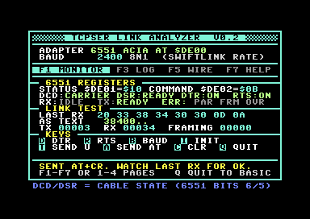
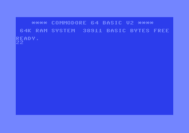

# TCPSER LINK ANALYZER — C64 side (v0.2)

An interactive Commodore 64 program that pairs with **tcpser** to diagnose an
RS232 cartridge and its cabling. It runs on a real C64 (or in VICE) and reads
the 6551 ACIA registers directly, something the PC side of tcpser cannot see,
so you can watch the actual DCD / DSR / DTR / RTS handshake bits, send test
bytes, and read tcpser's replies on the C64 screen.

<p align="center">
  
  
</p>

> Status: **v0.2** — rewritten after the 2026-11 audit. Verified end to end in
> VICE: SwiftLink emulation talking ip232 to a live tcpser, with `AT` → `OK`
> and a full `RING` / `CONNECT` sequence arriving on the C64 screen.

## What it does

- Probes for a 6551 ACIA (SwiftLink, Turbo232, GLINK232) at `$DE00`, then
  `$DF00` (the alternate jumper setting). The probe saves and restores the
  control register, so it leaves the chip exactly as it found it.
- Initialises the chip to **8N1, DTR + RTS asserted, interrupts off** at a
  selectable baud rate (300 … 38400, shown as the real SwiftLink-doubled rate).
- **Live register readout**, decoded to the state of the RS232 *cable* lines
  (see "Pin swap" below): DCD (carrier from tcpser), DSR, DTR, RTS, receiver
  full, transmitter ready, and latched parity / framing / overrun errors.
  Framing errors mean the baud rate is wrong.
- **Receive log**: a 256-byte ring. The MONITOR page shows the last 8 bytes
  as hex and text; the LOG page shows a 48-byte hex dump and a 144-character
  text view, so a whole `RING` / `CONNECT 38400` exchange is readable.
- **Link tests**: send `AT` + CR and watch for tcpser's `OK` (this is the
  baud-rate test), or send 16 × `$55` ('U', the alternating-bit auto-baud
  pattern). TX / RX / framing counters are 16-bit.
- Four pages: **F1 MONITOR**, **F3 LOG**, **F5 WIRE** (cable diagram and the
  pin-swap explanation), **F7 HELP**. The keys 1–4 select pages too.

### Keys

| Key | Action |
|-----|--------|
| `D` | toggle DTR (command register bit 0) |
| `R` | toggle RTS (transmitter control bits; never selects "transmit BREAK") |
| `B` | next baud rate: 300, 1200, 2400, 4800, 9600, 19200, 38400 |
| `I` | reset the ACIA: 8N1, DTR + RTS on, no interrupts |
| `T` | send 16 × `$55` |
| `A` | send `AT` + CR |
| `C` | clear the log and counters |
| `Q` | quit back to BASIC (restores screen colours) |
| `F1` `F3` `F5` `F7` or `1`–`4` | pages |

### How to use it with tcpser

1. On the PC: `tcpser -d /dev/ttyUSB0 -s 2400 -p 6400` (or `-Z` for the
   analyzer). Start the C64 program.
2. Press `A`. If `LAST RX` shows `..OK..`, the baud rate matches. If it shows
   garbage or `FRAMING` counts up, press `B` to try the next rate and `A`
   again.
3. Press `D` and `R` while watching tcpser's log at `-l 4`: it prints
   "DTR has gone low/high" as the control lines change, which tells you how
   the cable is wired. The F5 page shows the expected cable.
4. Press `F3` to read everything tcpser sent (banner, RING, CONNECT …).

## Pin swap: why DCD is status bit 6

The 6551's status register has `/DCD` on bit 5 and `/DSR` on bit 6, both
active low (a **0** bit means the line is asserted). SwiftLink-class
cartridges wire the RS232 **DCD** pin to the chip's **DSR** input and RS232
DSR to the chip's DCD input, so that the 6551 receiver (which is gated by its
own DCD input) keeps working without carrier. The analyzer therefore reads
the cable's DCD from bit 6 and DSR from bit 5, and the footer says so. This
was verified in VICE's SwiftLink mode: when tcpser raises DCD, status goes
from `$50` to `$10` (bit 6 clears).

The v0.1 version showed `DCD: ON` whenever bit 5 was set, which is the
*inactive* state of the wrong line; it also reprogrammed the chip to 19200
baud as a side effect of the detection probe, toggled a command-register bit
that could select "transmit BREAK", had no receive display at all, and hung
on quit. All fixed in v0.2.

## Build

Requires **cc65** (`ca65`/`ld65`) and, for VICE targets, **VICE** (`x64sc`,
`c1541`).

```sh
make            # -> tcpser-link.prg and tcpser-link.d64
make run        # launch in VICE (no 6551: shows the "NONE" state)
make shot       # headless render of that state to shot.png
make shot-live  # headless render of a LIVE session against ../tcpser over ip232
make run-live   # interactive VICE session against ../tcpser over ip232
```

The source is assembled **without** `-t c64` on purpose, so string literals
stay raw ASCII (`$41-$5A`), which character set 1 prints as uppercase. For the
same reason every state word on screen is uppercase: lowercase ASCII would
render as graphics glyphs.

### Testing in VICE against tcpser

`make run-live` wires it all up: `../tcpser -v 25232 -p 16901 -i S0=1`
(ip232 on loopback, auto-answer), and VICE with
`-acia1 -acia1base 0xDE00 -acia1mode 1 -acia1irq 0 -myaciadev 0 -rsdev1
127.0.0.1:25232 -rsdev1ip232`. Press `A` on the C64 and `OK` appears; connect
a telnet client to port 16901 and `RING`, `CONNECT` and the carrier light
appear. This is how the screenshots above were made.

## Run on hardware

- **Real C64**: copy `tcpser-link.d64` to an SD2IEC / 1541 Ultimate / real
  disk and `LOAD"*",8,1` then `RUN`, or transfer `tcpser-link.prg`.
- **VICE** without tcpser: `x64sc -autostart tcpser-link.prg` shows
  `ADAPTER NONE` unless ACIA emulation is enabled.

Detection caveat: the probe cannot tell a 6551 from RAM mapped at `$DE00`
(GeoRAM, some REU register pages). Remove other I/O-area cartridges while
testing.

## Files

| File | Purpose |
|------|---------|
| `tcpser-link.s` | 6502 source (ca65), ~1 100 lines, commented |
| `c64prg.cfg`    | ld65 config (emits a `$0801` .prg with a BASIC stub) |
| `Makefile`      | build / run / live-test / screenshot targets |
| `tcpser-link.prg` / `.d64` | built program (shippable) |
| `shot.png`, `shot-log.png` | VICE renders of the MONITOR and LOG pages |

## Roadmap

- Cooperative auto-negotiation with tcpser's `-Z` analyzer: the C64 sends the
  `$55` training pattern, tcpser detects the rate, asserts DCD, and both sides
  print the known-good `tcpser` command line and C64 init.
- Turbo232 enhanced-speed register (`base+7`) for 57600 / 115200 / 230400.
- User-port (software UART) adapters are out of scope: no 6551 to read.
